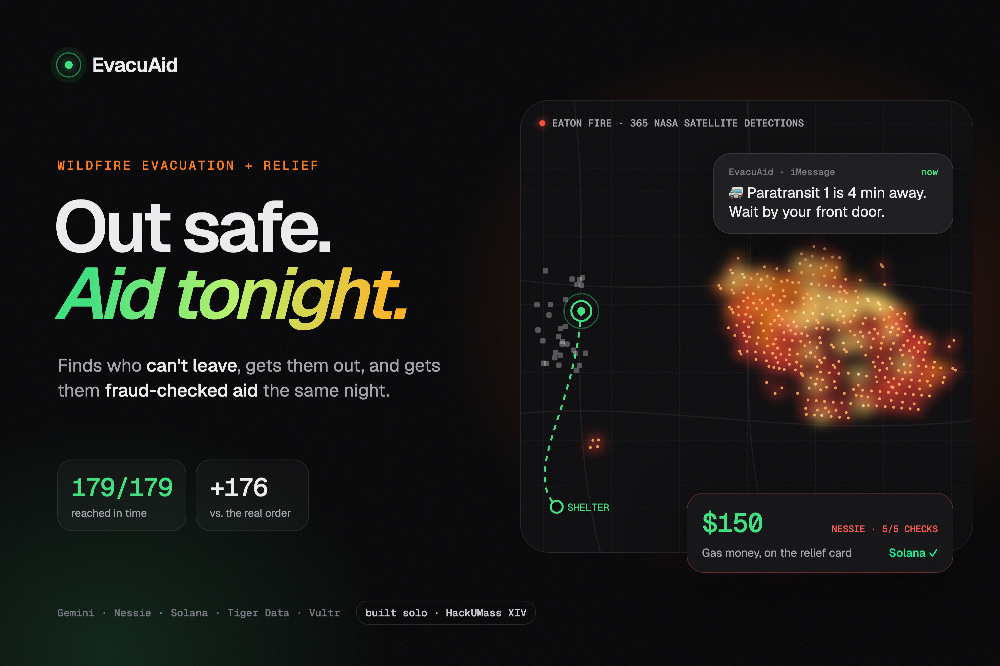

# EvacuAid

**Out safe. Aid tonight.** EvacuAid finds who can't leave a disaster zone (wildfire, flood, hurricane, earthquake), gets them out with operator-approved vans, and gets them fraud-checked relief money the same night, while every donor can see where their gift went.

**Live:** [evacuid.us](https://evacuid.us) · [Pitch](https://evacuid.us/pitch) · [Donate on Solana devnet](https://evacuid.us/donate) · [Solana program](https://explorer.solana.com/address/HZYxz8EF9iqNERbZucuTygzGVHNc9xfrw1YtwEqYBV3?cluster=devnet)

Built solo at HackUMass XIV.



> **Altadena, January 8, 2025.** Anthony Mitchell Sr., 67, couldn't walk on his own. His son Justin had cerebral palsy. They called for an ambulance. They waited.
>
> **It never came.** ([NPR](https://www.npr.org/2025/01/13/g-s1-42506/la-fires-victims-altadena-eaton-anthony-mitchell))

## Inspiration

The Eaton fire killed 19 people. **18 of them died in west Altadena, where the evacuation order came last.** NASA satellites saw fire at those homes at **1:02 AM**. The order went out at **3:25 AM**. It was one-way: it told people to leave, and never asked who *couldn't*.

**16 of the 19 couldn't leave alone.** They were elderly, disabled, or had limited mobility ([NBC News](https://www.nbcnews.com/news/us-news/los-angeles-california-wildfires-victims-no-escape-rcna191087)). Los Angeles had **no list of who needs a ride**, and is only now building one ([Firehouse](https://firehouse.com/california-fire-storm/news/55262499/ca-wildfires-show-need-for-database-of-disabled-residents)). Most alerts went out in **one language**, in a neighborhood that speaks many.

Then I kept reading, and found the second half of the story. The people who survived **couldn't get help either**:

- **Aid arrives after the fire.** FEMA's $770 needs a declaration and an application. Months later, survivors were still being denied housing help ([LAist](https://laist.com/news/climate-environment/fema-aid-la-fires)) and waiting on one emergency check ([NPR](https://www.npr.org/transcripts/nx-s1-5704233)).
- **The people who need it most can't front it.** If you have no car, "evacuate now" means a ride, gas, a room tonight. Reimbursement next month gets nobody out.
- **Fraud drains it.** LA fire aid was claimed with fake addresses ([DOJ](https://www.justice.gov/usao-cdca/pr/5-defendants-arrested-complaints-alleging-they-submitted-fraudulent-claims-seeking)).
- **Donors can't see where it goes.** The Red Cross raised $500M for Haiti and built 6 homes ([NPR](https://www.npr.org/2015/06/03/411524156/in-search-of-the-red-cross-500-million-i)). So people stop giving.

**The problem is two-fold: they couldn't get out, and then they couldn't get help.** Every tool I found solves the first half and stops at the van. I wanted to build the whole night: get everyone out, get them the money they need *while they're leaving*, and let every donor see exactly whose life their gift touched.

## What it does

EvacuAid is an emergency operations system for a county: one console, one relief fund, one public donation page, one iMessage number. I proved it on a wildfire, but nothing in it is fire-specific: it works for anything that needs people out and aid in, from floods and hurricanes to earthquakes and chemical spills.

### 1. Get everyone out

- **A two-way alert, hours early.** When the fire forecast reaches a home, EvacuAid texts it over **real iMessage** (Photon) and *asks*: `1` leaving on my own · `2` need a ride · `3` need help (wheelchair, oxygen, no car).
- **Any words, any language.** People don't reply "3". They write *"my mom can't walk and the car's in the shop"*, or *"mi esposo usa silla de ruedas"*. **Gemini** turns that into a structured case in about 2 seconds: needs, who's left behind, emergency or not, language, and a one-line summary for the operator. It replies in their language.
- **A case, and the best van.** Ride, aid, or a door knock. EvacuAid suggests the closest free vehicle that can actually carry them (a wheelchair user only gets a wheelchair-capable van).
- **A person decides.** An operator approves every dispatch in one click. AI suggests; humans decide.
- **The resident sees every step,** by text: *dispatched, 6 min away* → *outside* → *on board* → *checked in at the shelter*. When the van is outside they reply **IN** once seated and it leaves right away (no reply, it leaves after a short wait). Every step texts once, never twice, and the last text reminds them to reply **STOP**.
- **They can watch the van come.** The dispatch text carries a private link (`evacuid.us/t/…`) to a live page: the van moving on a map toward their home, then to the shelter, a countdown, and the four steps, in English or Spanish. Each trip gets a fresh, unguessable code that shows only that trip (no name, no phone). Dispatching a new van or resetting the drill ends the old link. The van's position is estimated from the trip plan; with a real fleet it would come from the driver's phone.
- **Nobody goes silent.** No reply means two more texts, then a door knock. Every case stays open until someone is checked in.

### Who goes first: a race between the fire and the household

Every household gets a priority score, recomputed every replay minute and shown with its reasons on the operator's console. Two numbers decide it.

**P, the chance the fire wins the race.** Let $A$ be when the hazard reaches the home (for a wildfire, from the satellite-measured spread rate) and $T$ how long the household needs to get out on its own. Fire timing is uncertain, so $A$ is lognormal with $\sigma = 0.35$ (the fire arrives anywhere from 0.6× to 1.8× the forecast, 90% of the time):

$$P(\text{trapped}) = P(A < T) = \Phi\left(\frac{\ln T - \ln A}{\sigma}\right)$$

$T$ adds up real minutes: 30 to get moving, 20 to drive out, +60 for a wheelchair, +45 for oxygen or dialysis, +15 for kids, +10 for pets, +30 if they haven't replied. With no car it's at least 240 minutes, waiting for a ride. If they asked for help it's 360: only a rescue gets them out. Inside an ordered zone, $P$ never drops below 0.5.

**V, the harm if they're trapped.** Independent risk factors from the CDC Social Vulnerability Index combine as:

$$V = 1 - \prod_i (1 - w_i)$$

with weights for medical dependence 0.6, can't walk 0.5, someone left at home 0.4, age 75+ 0.3, silent after two texts 0.3, children 0.15, not English 0.1, and a 0.1 baseline so nobody is ever zero.

$$\text{priority} = P(\text{trapped}) \times V$$

A wheelchair user on oxygen who asked for help, with the fire 90 minutes out, scores **0.82**. A family with a car on the same street scores **0.05**. Highest priority goes first, to the nearest free vehicle that can carry them (wheelchair-capable when needed, with enough seats), and the operator approves.

### 2. Get them the money, tonight

- **Two questions size the aid:** $150 (gas) · $315 (gas + a night) · $770 (full, the FEMA household figure).
- **Five bank checks before a dollar moves,** on real card history in **Capital One's Nessie**: residency (ZIP), whereabouts (where was this card an hour ago?), account history, the $770 household cap, and story vs. spending. That's how EvacuAid catches the "evacuee" whose card was swiped in Las Vegas.
- **The operator approves, holds, or declines,** always with a reason. A held claim moves **$0** until a person says yes.
- **Money lands on a relief card in seconds,** and the card **only buys evacuation**: gas, rooms, food, pharmacy approved; electronics declined.
- **Every rescue is billed live** to County Emergency Operations: $95 paratransit, $70 van, $25 volunteer fuel.

### 3. Let everyone see it

- **Donors give to a pool on Solana** with the rules written in code: money only moves for zones the county actually ordered out, never more than **$770 per home**, and only to the county's relief account. Not even a stolen key can send it elsewhere.
- **Nessie pays the family first. Solana pays the county back.** Each release is deposited into the county's Solana bridge account on Nessie, and each one records the Nessie transaction that paid the family. Chain and bank point at each other, end to end.
- **Every donor gets a receipt** naming the families their gift reached. The pool is shared, so each release draws from your gift in proportion to what it still makes up of the pool:

$$\text{from you} = \min\left(\text{your remaining gift},\ \text{release} \times \frac{\text{your remaining gift}}{\text{pool before the release}}\right)$$

- **The county gets its money back.** One click exports every approved dollar, itemized with its Nessie transaction ID, for FEMA's 75% Category B reimbursement.

### 4. Plan for the worst hour

- **Will the money last until morning?** A Monte Carlo model simulates **2,000 nights per plan** (6,000 per refresh) and re-runs every 15 replay minutes, as money moves.
- **A best-plan optimizer** searches up to 98 policies. It found that $770 + shelter-first lasts the night **90% of the time (up from 58%)** and saves $9,240.
- **A budget sandbox:** change aid size, shelter share, room nights, fire speed and pool size, and watch the odds move.
- **Tiger Data remembers everything.** Every text, case, dispatch and dollar is a row in a TimescaleDB hypertable, with live 5-minute charts tonight and the after-action report tomorrow.

## Did it work? I replayed the real night.

I didn't invent a fire. EvacuAid replays **the actual Eaton fire** from **365 NASA FIRMS satellite detections**, on the real streets of Altadena, against the real 3:25 AM order. The residents are simulated; the fire, the streets and the timeline are real.

The model alerts from a worst-case forecast (ignition at 1.7 km/h), but scores every outcome against when satellites *actually* saw fire at each home. My first model said fire reached west Altadena at ~10 PM. The satellites said after 1 AM. I threw out my own number and used theirs.

**200 paired runs** (same reply times, same fire uncertainty for every scenario), **179 people in 114 homes who can't leave alone**, **22 vehicles**:

| Scenario | Alert | People out before the fire |
|---|---|---|
| What happened | One-way, **3:25 AM** | **~3 of 179** |
| A fairer baseline: alert the moment satellites saw fire | One-way, **1:02 AM** | **~97 of 179** |
| **EvacuAid** | **Two-way, 6:49 PM** | **179 of 179** |

**+176 people**, the same gain in every one of the 200 runs, with a median of **about 4.5 hours** to spare. I made the baseline as generous as I could: it even knows who needs a ride. It still loses, because a one-way alert can't hear "I can't."

## Fire is the proof, not the limit

The roll call, the triage, the priority score, the vans, the aid, the fraud checks and the donor receipts don't care what the disaster is. Only one input changes: the feed that says **when the hazard reaches each home**.

| Disaster | What sets the clock | What changes |
|---|---|---|
| **Wildfire** (the demo) | NASA satellite fire detections | Proven on the real Eaton fire |
| **Flood** | River gauges and flood forecasts | When the water reaches each street |
| **Hurricane** | Storm-surge and wind forecasts | Days of warning, the same two-way roll call |
| **Earthquake** | Damage and aftershock reports | No warning: find who's trapped or can't leave a damaged home, and house them tonight |
| **Chemical spill** | Plume models | Minutes to clear a zone, in every language |

Every one of them leaves the same people behind: no car, a wheelchair, oxygen, no English, no money for a room tonight.

## What makes it different

| | Evacuation tools | **EvacuAid** |
|---|---|---|
| The disaster | Built around one hazard | Any evacuation: fire, flood, hurricane, earthquake, chemical spill |
| The proof | A modeled disaster on a map | The real Eaton fire: 365 NASA detections, the real 3:25 AM order |
| The people | Synthetic households | Real phones. Text EVAC right now and an operator answers |
| Reaching them | A browser call or a one-way alert | Two-way iMessage, any language, on the phone they already have |
| Who decides | An algorithm assigns | AI suggests; a person approves every van and every dollar |
| After the pickup | The story ends at the van | Sized aid the same night, on a card that only buys the way out |
| Fraud | Not considered | Five bank checks on real card history; a blocked claim moves $0 |
| Donors | Not considered | On-chain rules, public releases, a receipt naming who they reached |
| The budget | Not considered | 6,000 simulated nights per refresh: will the money last till morning? |
| The county | Not considered | Every rescue billed, every dollar itemized for FEMA's 75% back |
| Running it | A demo that dies with the laptop | Live at evacuid.us on Vultr: HTTPS, backups, a standby server |

**Why it matters for society:** disasters don't just burn houses, they burn trust. People don't give because they can't see where it goes, and people don't get help because nobody asked them. EvacuAid uses AI to listen to the people who usually go unheard, and uses open, auditable money so a whole community can see its generosity land. When donors can watch a gift become a tank of gas for a neighbor at 9 PM, they give again. **That's how a town holds together through its worst night.**

## How I built it

I built EvacuAid **solo**: ~12,000 lines of TypeScript, 297 lines of on-chain Rust, 34 automated tests.

```
resident's iPhone ⇄ Photon iMessage ⇄ EvacuAid (Next.js 16) ⇄ Gemini (triage)
                                        │
          operator console ─────────────┼──── Nessie: fund, checks, cards, bills
          relief fund page ─────────────┼──── Solana: donor pool with rules in code
          public donate page ───────────┼──── Tiger Data: every event, by the minute
                                        │
              evacuid.us ── Vultr (HTTPS, firewall, tunnel, standby)
```

### Capital One Nessie: not just a ledger

Nessie is EvacuAid's bank, fraud engine, budget simulator and the rescue's accounting.

- **4 kinds of wallets** keep money that must never mix apart: the county relief fund ($120k), County Emergency Operations ($250k), the Solana bridge, and a checking account + relief card per household.
- **10 endpoints, each with a job:**
  - `POST /customers` makes one customer per home; the ZIP is the residency check.
  - `POST /customers/{id}/accounts` opens the relief fund, rescue ops, the bridge and a card per family.
  - `POST /merchants` adds real gas stations, hotels and pharmacies on the routes.
  - `GET /accounts/{id}/transactions` answers "where was this card an hour ago?" for the fraud checks.
  - `POST /accounts/{id}/transfers` sends aid to the relief card, only after approval.
  - `POST /transactions/{id}/decision` approves, holds or declines, always with a reason.
  - `POST /accounts/{id}/purchases` records card swipes and bills every van trip, live.
  - `POST /transactions/{id}/settle` and `GET /transactions/{id}` show the money actually land.
  - `GET /accounts/{id}` gives live balances for the fund, the cards and the pool.
- Plus `POST /accounts/{id}/deposits` for donor repayments from Solana.

### Solana: donor money with rules in code

- An **Anchor 1.2.2** program, `relief_pool`, deployed on devnet with its IDL on-chain ([program](https://explorer.solana.com/address/HZYxz8EF9iqNERbZucuTygzGVHNc9xfrw1YtwEqYBV3?cluster=devnet)).
- **4 instructions:** `init_pool` · `donate` · `publish_order` · `release`.
- **PDAs** for the pool, the token vault, a zone per evacuation order, and a claim per household hash, so a home can't double-dip.
- **Rules enforced on-chain** (`ZoneNotOrdered`, `OverHouseholdCap`, `WrongPayout`), each one proven refused on devnet. `has_one county_payout` means money can only ever go to the county.
- SPL tokens (a 6-decimal test dollar standing in for USDC), moved by `transfer_checked` CPI with a PDA signer.
- The console's **Send alert** publishes the zone order on-chain. Public `/donate` sends a real devnet `donate()`.

### Gemini: turning panic into a case

- `gemini-3.5-flash-lite` through the Interactions API, with minimal thinking, for about 2 seconds per message.
- A **management prompt** with the mission, the 14 conversation stages, needs, safety rules, and worked examples in English and Spanish.
- **Structured JSON output:** status, stage, needs, leftBehind, emergency, offerStipend, language, summary, reply. **Code decides; AI reads.**
- **Guardrails:** it never promises a ride or an amount. If it says "on the way" before an operator dispatched, code replaces the line.
- A **hybrid engine:** a 14-stage state machine answers menu replies instantly and for free; Gemini handles everything else. If Gemini fails, keyword rules answer, so **no text is ever dropped**.

### Tiger Data: the incident's memory

- An `evac_events` **hypertable** (1-day chunks) with 18 event kinds: texts in/out, cases, dispatches, Nessie and Solana transactions.
- A **continuous aggregate** `evac_events_5min` using `time_bucket('5 minutes')`, real-time, refreshed every minute.
- A **compression policy** (segment by run and kind) and an index on `(run, kind, time desc)` so the console's per-run queries return in milliseconds.
- **Fire-and-forget writes:** analytics can fail; a ride can't.

### Vultr: the always-on front door

EvacuAid isn't a stateless website. It holds a live roster, checks iMessage every 2 seconds and times every van trip, which serverless functions forget between requests.

- A **Vultr Cloud Compute** server (Ubuntu 24.04) holds the public address **evacuid.us**.
- **Caddy** provides automatic HTTPS, and **ufw** leaves only SSH, 80 and 443 open.
- An **SSH reverse tunnel** carries evacuid.us to the operator station, so there's exactly one live copy and no resident ever gets two replies.
- A **full standby copy** of the app (Node 22, systemd, restarts in 2 s) can take the whole night in one command, data included.
- **Deploys can't break the site:** each build goes into a new folder, 34 smoke checks run on the real domain, and anything that fails rolls back automatically.
- **Nightly backups**, 14 kept.

### The rest

- **Next.js 16 + React 19 + Tailwind 4**, MapLibre + MapTiler for the live fire map, Photon for iMessage, Bun and Vitest.
- **Security:** operator sign-in with jose-signed sessions and scrypt-hashed passwords. Every write API refuses without a session. The public sees redacted data, and the web phone only accepts fictional 555 numbers.
- **Nothing is ever lost:** restarts keep the whole night. Resetting a drill archives it as a run in History. Real phones are never removed; only replying STOP turns one off.

## Challenges I ran into

- **Being honest about the fire.** My forecast said flames reached west Altadena hours before satellites did. Showing it would have made EvacuAid look better and been a lie. I split it: the worst-case forecast drives alerts, and the real satellite times score the results.
- **Money that moved without a human.** Nessie settles pending transfers on its own sweep, so held claims were getting paid without anyone deciding. I rebuilt the flow so a held claim creates **no transfer at all** until an operator approves.
- **Resets that erased real people.** An early "reset drill" wiped the roster, including real phone numbers. I redesigned it: every run is archived to History, phones are never deleted, and only STOP turns one off.
- **A bank and a blockchain that can't talk.** Nessie and Solana are separate sandboxes. I designed the hand-off so each side records the other's transaction ID, and every Solana release now lands as a deposit in the county's bridge account on Nessie.
- **Two copies, double texts.** You can only *read* Photon messages, so two running servers both reply to everything. The answer was one live copy: evacuid.us runs through Vultr to a single operator station, with a standby that takes over in one command.
- **Restarts that forgot conversations.** The links between phones and iMessage threads lived in memory, so after a restart the app couldn't text anyone first. They're now saved with the night's data.
- **Server code leaking into the browser.** Saving operator actions to disk pulled Node's filesystem into the console bundle and crashed it. I split the pure trip math out from the persistence.

## Accomplishments I'm proud of

- **The whole night, end to end, on real phones.** A judge can text EVAC, get triaged in their own language, watch an operator send a van, see aid land on a card, and see a donor's receipt name them.
- **+176 people on the real fire's timeline**, against a baseline I made as generous as I could.
- **Every sponsor platform is load-bearing.** Take any one away and a piece of the rescue breaks: no Nessie, no fraud check; no Solana, no donor trust; no Gemini, no understanding; no Tiger, no memory; no Vultr, no front door.
- **Built solo**, with the same care as production: tests, auth, backups, rollbacks.

## What I learned

- **Rescue is a listening problem.** The people who die aren't the ones who didn't get the alert. They're the ones nobody asked.
- **Money is a rescue tool.** People stay because leaving costs money, so aid that arrives after the fire can't get anyone out.
- **Trust is infrastructure.** Rules in code and public receipts do what "trust us" never could.
- **AI should read, and people should decide.** Gemini is extraordinary at understanding a frightened message. Approving a van or a dollar belongs to a person.
- **Honest numbers beat impressive ones.** Throwing out my own fire timing made the result smaller and far more believable.

## What's next

- Pilot with a county emergency office and paratransit providers, alongside 911 and official orders, never instead of them.
- An **opt-in registry** of people who can't leave alone, with consent, minimum data and retention limits.
- Real USDC on Solana mainnet, and a real bank partner for relief cards.
- Voice calls and landlines for people without smartphones, and more languages.
- Hotels invoicing the county directly, 0% advances above the stipend repaid by FEMA, and chargebacks for claims later proven fraudulent.

**Nobody should have to wait for an ambulance that never comes, or for a check that comes too late.**

*Residents in the replay are simulated; the fire, the streets and the timeline are real. In an emergency, call 911.*

## Run it locally

```bash
bun install
cp .env.example .env.local      # add your keys (Gemini, Nessie, MapTiler, Tiger Data, Photon, Solana keypair path)
bun scripts/set-admin.ts        # create the operator login
bun run dev                     # http://localhost:3000
```

| Page | What it is |
|---|---|
| `/` | Landing page and sign-up (real phones, over iMessage) |
| `/console` | Operator console: Eaton fire replay, live map with moving vehicles, priority queue, cases, money |
| `/relief` | Relief fund: balances, live Nessie and Solana transactions, budget plans, Tiger Data charts, history |
| `/donate` | Public donations to the Solana pool, with receipts naming the families reached |
| `/phone` | Web phone that texts EvacuAid through the same pipeline as iMessage (fictional 555 numbers) |
| `/pitch` | The pitch |

## Checks

```bash
bun run test                                        # unit tests
bun --env-file=.env.local scripts/check-keys.ts     # every API key works
bun scripts/smoke.ts [url]                          # every page and API route
bun --env-file=.env.local scripts/e2e-local.ts      # a full rescue + aid, end to end
```

## Deploying

evacuid.us runs on a Vultr server (Caddy for HTTPS) that tunnels to the operator station. See [deploy/README.md](deploy/README.md) for setup, one-command deploys with automatic rollback, and switching between the server and a laptop.

Fire data: NASA FIRMS (VIIRS, MODIS). Demonstrated on the Eaton fire; built for any evacuation. Residents in the replay are simulated; the fire, the streets and the timeline are real. In an emergency, call 911.
